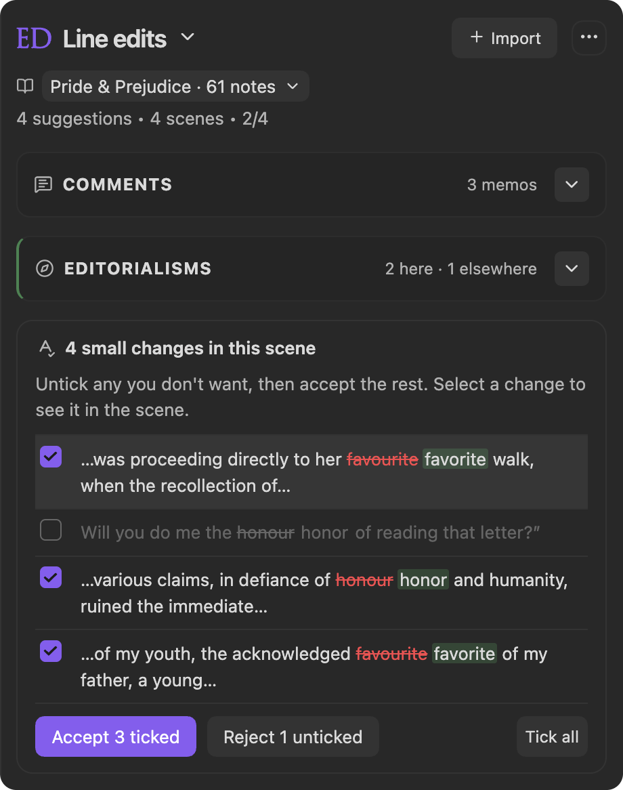
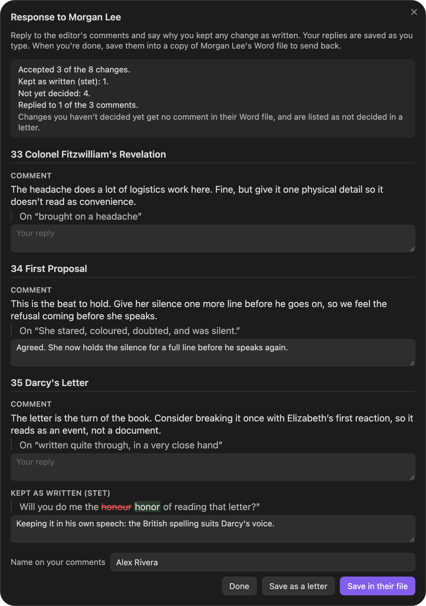

  <picture>
    <source media="(prefers-color-scheme: dark)" srcset="https://raw.githubusercontent.com/EricRhysTaylor/Editorialist/main/logo.png">
    <source media="(prefers-color-scheme: light)" srcset="https://raw.githubusercontent.com/EricRhysTaylor/Editorialist/main/logo-light.png">
    <!-- Fallback img is the WHITE logo: renderers that ignore <picture> (e.g. the
         community.obsidian.md listing page, which is dark-themed) show this one. -->
    
  </picture>

  Editorialist

  by Eric Rhys Taylor

## What it does

Editorialist turns outside feedback into a controlled revision workflow inside Obsidian. An editor's Word file with tracked changes and comments comes in directly, with no AI. Other feedback arrives as review batches in Editorialist's format, packaged by an AI: either the AI's own review, or a human editor's or beta reader's notes that an AI has converted. Editorialist imports each batch into the scene notes you are already editing, matches suggestions conservatively against note content, and lets you accept, reject, rewrite, defer, or archive each change. Long-form editorial agendas become Editorialisms, checklists pinned to the passages they concern, and **Editor engagement** schedules all of it, along with your own pending edits, against your deadline while tracking progress across the whole book.

Version **3.2.0** brings every book onto **Today**, naming the book on each session, and lets **Follow Radial Timeline** switch between your books from Editorialist.

Version **3.1.0** added a complete workflow that needs no AI. An editor's Word file comes in with its tracked changes and comments, a scene's small copy edits can be accepted as one ticked list, and your replies and your reasons for the changes you kept go back into a copy of their own Word file. [Working with a Copy Editor](https://github.com/EricRhysTaylor/Editorialist/wiki/Working-with-a-Copy-Editor) walks the round trip step by step. It also added **Today**, which opens on the session to do now, the rest of the day, what is coming up, and your goals under way. Writing goals can count words written in a folder, and engagement documents can carry a word limit. **Editor engagement** keeps an editor’s agreed dates, milestones, tasks, references, and activity history together; **Author planner** gives your own writing goals a vault-wide home, optionally sharing publishing-stage target dates with Radial Timeline.

 

Read the [user manual](https://github.com/EricRhysTaylor/Editorialist/wiki), including [Word files with tracked changes](https://github.com/EricRhysTaylor/Editorialist/wiki/Importing-Reviews#word-files-with-tracked-changes), [Responding to your editor](https://github.com/EricRhysTaylor/Editorialist/wiki/Importing-Reviews#responding-to-your-editor), [Editor Engagement](https://github.com/EricRhysTaylor/Editorialist/wiki/Editor-Engagement) and [Author Planner](https://github.com/EricRhysTaylor/Editorialist/wiki/Author-Planner).

## Watch

An editor's round from start to finish: the notes come in, the AI you choose formats them, Editorialist plans the revision against your deadline, and every decision stays yours. Part of the series on the [Radial Timeline YouTube channel](https://www.youtube.com/@RadialTimeline).

## How it works

- In the review launcher, choose your editor's Word file with tracked changes, or copy the instructions for AI, send them with the prose or notes you want reviewed, then paste the formatted response back into Editorialist.
- A **review batch** is the set of changes to review: line edits, cuts, moves, condenses, expands, and memos, from the Word file's tracked changes and comments or from the AI's formatted response.
- Importing a batch appends **review blocks** to the bottom of the targeted scene notes. Nothing is applied to the prose until you act on a suggestion.
- The Line edits view walks those suggestions scene by scene and records contributor stats, revision history, and per-scene progress as you finish. A scene's small copy edits show as one ticked list to accept together, with **Undo all**.
- For a pass from a person, **Reply** answers their comments and **Say why you kept it** explains a change you kept. **Write your response** saves those answers into a copy of the editor's Word file, as replies to their comments, or as a separate letter.
- When a suggestion bears on other scenes, the selected suggestion card shows them under **Across scenes**; **Open beside** opens that scene in a side pane without losing your place.
- **Manuscript targeting** works independently: choose a folder, pin one note, select the whole vault, or follow Radial Timeline, which lists your books and switches both plugins to the one you choose. Folder targets support exclusions and optional subfolders; the current target stays visible beneath the panel header. Known folder renames carry saved work with them; use **Reconnect…** in the target selector to review a missing folder’s replacement or update a standalone manuscript name. Existing destination records are retained and never silently combined.
- **Editorialisms** are separate structural checklist files under `Editorialist/<Book>/`; use them for broader guidance that spans scenes or the whole manuscript. A directive can carry **anchors** — verbatim fragments pinning it to the passages it is actually about, so a manuscript-wide note becomes a short route through the prose instead of a hunt. Anchors are jump targets only; nothing is ever applied for you.
- A directive that asks for a choice shows **Decision needed**: record the answer once with **Decide**, or write your own question with **Ask a question…**. Each Editorialism's **Hand off to AI** card copies one prompt covering every unfinished directive you have decided or questioned; the edits and answers come back through Import as a review batch.
- An **editorial delivery** groups one editor's handoff (its batches and Editorialism files, received date, and return deadline) so you can track and plan it as a unit.
- **Editor engagement** records the editor’s start and return dates, questions window, milestones, tasks, optional references, and sent/received activity. File exchange stays in your collaboration; records describe what you record locally. Its schedule puts batches, directives, and pending edits in one queue against your deadline and daily capacity. **Auto-plan** spreads every open item in the book across your working days, and the progress card counts finished work across the whole book, planned or not.
- Maintenance actions can clean review blocks or reset history, and bulk actions ask for confirmation.

## How feedback gets in

Editorialist does not write feedback and never calls an AI itself. Feedback reaches it in one of two ways.

**Your editor's Word file.** In the review launcher, choose the Word file your editor returned. Each tracked change becomes a line edit to accept or reject, their comments come with it, and no AI is involved.

**Through an AI.** Any other feedback reaches Editorialist in its review format, and packaging feedback into that format is an AI's job:

1. Copy the instructions for AI from the review launcher.
2. Give them to the AI you choose, along with the scenes to review, or along with a human editor's or beta reader's notes for the AI to convert.
3. Paste the AI's formatted reply back into Editorialist's import.

It's a format, and a suitably capable AI can follow it; smaller local models may not. Editorialist makes no network calls and holds no API keys.

From there, Editorialist runs the workflow: it matches each suggestion to its passage, walks you through accepting, rejecting, or rewriting them scene by scene, tracks editorialism directives and your decisions, and schedules the work against your deadline.

## Commands

- `Open today` — opens Today: the scheduled session to work on now, the rest of today, what is coming up, and your goals under way, across all your books. Each session names its book, and **Start** switches to it. The Ed ribbon icon opens it too, and the panel shows it the first time Obsidian starts each day.
- `Open review launcher` — opens the launcher modal to import a review batch or start pending-edits review.
- `Open line edits` — opens the line edits panel (the scene batches under review) for the active note.
- `Open editorialism panel` — opens the Editorialisms panel for structural guidance documents.
- `Open editor engagement` — orders mixed revision work and plans author estimates against daily capacity and a deadline.
- `Open author planner` — vault-wide writing goals with optional word counts, document links, book labels, start and target dates, hard deadlines, and capacity scheduling. Optionally link a goal to a Radial Timeline book and publishing-stage target for two-way date sync.
- `Open editorial project in workspace` — opens the planner in a full workspace tab. Use **Create engagement** to record agreed dates, personal milestones, tasks, optional document references, and editorial activity history.
- `Open pending edits panel` — opens the Pending edits panel for author notes and Inquiry follow-ups.
- `Review pending edits in active book` — starts the pending-edits review flow across the active book.
- `End current round` — removes the current batch or all remaining batches in the book, keeping manuscript edits and decision counts. Unfinished feedback is marked ended early; no archive is created.
- `Rescan review blocks for cleanup` — re-scans scene notes for review blocks ready to be cleaned.
- `Backup selection to cut file` — copies the selected text into the scene's cut file without changing the manuscript. Also available from the editor right-click menu when text is selected.
- `Write your response to the editor` — opens the response window for a pass from a person: reply to their comments, say why you kept changes, then save it into a copy of their Word file or as a letter.
- `Insert author query` — drops a `%%query: …%%` marker into the scene at the cursor (hidden in reading view), so your next review — your editor's or an AI's — answers it in a `QUERY` block. Markers written as `%%ai: …%%` before 3.0.0 still work. Also available from the editor right-click menu.
- `Anchor selection to editorialism directive` — pins the selected passage to an Editorialism directive so you can jump straight back to it later. Also available from the editor right-click menu.
- `Go to next unprocessed anchor` — opens the next anchored passage in the active Editorialism, across scenes.
- `Mark anchor processed and go to next` — records the current anchored passage as handled and advances.

Editorialist ships no default hotkeys. Assign your own from Obsidian's hotkey settings.

## License

Editorialist Source-Available Non-Commercial License. Free for personal,
educational, and professional creative work — including manuscripts and other
commercial creative output produced with the plugin. Commercial use of the
software itself, redistribution, and forks for public distribution require
written permission. See [LICENSE](LICENSE) and [NOTICE](NOTICE) for full terms.

  
  
  
   
  
  
  

