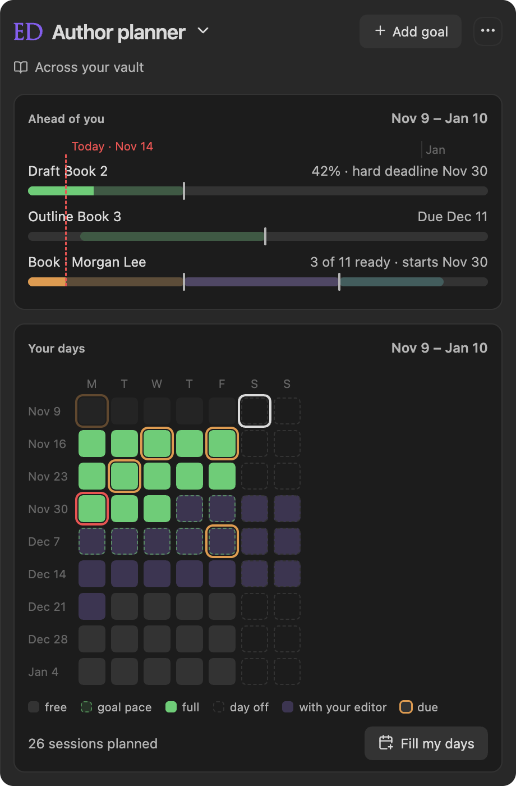
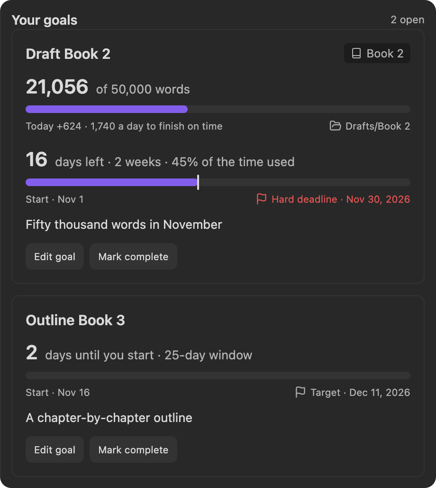
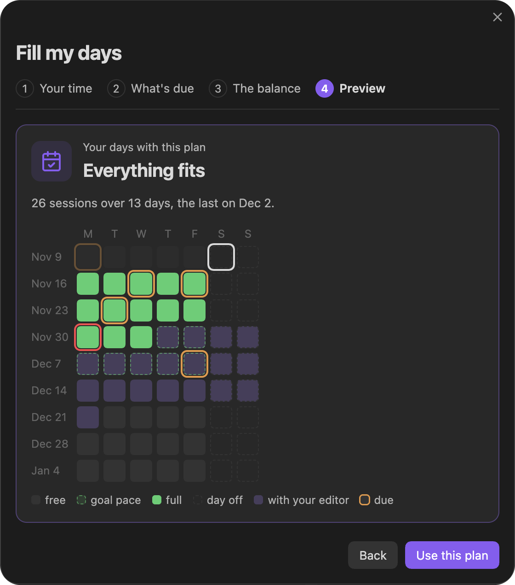

Give your own writing goals a target date and room in your working week. Run **Open author planner**, or choose **Author planner** from the panel’s mode selector. This plan spans the vault and stays separate from each book’s [Editor Engagement](Editor-Engagement).

## Add a writing goal

1. Choose **Add goal**. Under **Goal**, enter a **Title**, and under **Done means** describe finishing in your own terms: a revised chapter, a finished query letter, or another outcome.
2. Under **Dates**, set a **Target date**. Optionally set a **Start** date, the day you plan to begin; it must fall on or before the target date. Check **Hard deadline** when scheduling must finish by that date.
3. Under **Book**, keep **Standalone goal** and optionally add a **Book label**, or choose a Radial Timeline book (see below).
4. Under **Word count**, optionally give the goal a number of words to write (see [Word targets](#word-targets)).
5. **More options** holds a **Linked document** to open from the card and a low and high effort in minutes for scheduling. Most goals leave them empty.
6. Save. **Edit goal** lets you change these details later.

Each goal card counts down to its date. Before a goal’s start date, it shows the days until you start and the length of the window; after that, the days left, plus the weeks when at least two weeks remain. A goal with a start date also shows a bar of how much of the time from start to deadline has passed. The bar measures time, not how much of the writing is done. It turns amber in the last 14 days and red when the goal is due today or past due, and a hard deadline’s date is shown in red.

A document link opens the working file. Linking or editing it never completes the goal. **Mark complete** records your decision; **Reopen goal** brings it back. **Remove goal** removes that goal and its planned sessions while preserving the document.

## Word targets

A goal can also count words, such as 50,000 words in November. In goal details, enter **Words to write** and choose a **Folder to count**. Every note in that folder and its subfolders counts. When the goal is linked to a Radial Timeline book, it counts the book’s source folder instead.

**Starting count** is filled in with the folder’s current total. Words written after that count toward the goal. If you already wrote some words for this goal before you set it up, lower the starting count by that amount. When the start date is still ahead, leave the field blank and the folder is counted on your start date.

The card shows the words written so far against the target, with a bar. Below it are the words written today and how many words a day finish the goal by its date. The count follows your writing as you type, and you don’t need to start a timer.

The count is the folder’s total, so cutting words lowers it, and moving a note into the folder raises it. Cut files saved by Editorialist are not counted. The day’s count starts the first time Obsidian is open that day. Reaching the target doesn’t complete the goal; **Mark complete** is still your decision.

## Fill my days

**Fill my days**, under the squares, plans your goals and what is due to your editor together, so the two never claim the same hour. It also opens from the **Schedule** tab of an [editor engagement](Editor-Engagement). It opens on the plan itself, already worked out, and **Use this plan** saves it. You don't have to fill anything in: the hours are the ones you last set, and each piece of work comes with a time.

- A goal with a word count gets the words still to write at your **Drafting rate**, from Editorialist's settings. 25,000 words at 750 an hour is 33.5 hours. The time falls as you write.
- An engagement task gets an hour, until you give it a time of your own.
- A session that was in a plan without a day is planned again with the time it had.

When a goal needs more time than there is before its date, every day you have is planned and the preview says how much of the goal fits, in hours and in words. Nothing is left over without a day. Work due to your editor that finds no day is listed under **Not enough time**, with how much time your days have left before its date, and stays in that book's plan without one. Under either list, **To make it fit** has a button for each way to change it: give your days more hours, give the work less time, or change what comes first. Moving a date, in the engagement or the goal, works too.

A task due to your editor whose date has already passed is still owed, so it goes on the first day with room and is listed under **Past its date**. A task that cannot be placed never holds up the tasks after it.

Your days are filled, not cut into blocks: each piece of work takes what is left of each day in turn, so no time goes unused and a piece of work has one session a day at most. A day's leftover under a quarter of an hour is not given a session of its own.

The four steps above the plan change an answer in it. Click one to open it; nothing is saved until **Use this plan**.

1. **Your time.** The hours you can give to writing work on each day of the week and the day to start on. Leave a day at 0 to keep it free. These are the same hours for every book and every goal: change them here, or in any schedule's **Deadline & capacity**, and they change everywhere.
2. **What's due.** Each engagement task and each goal, with its date and the time filled in for it. Change any that looks wrong. Everything listed is planned: to plan a piece of work later, change its date, and to drop it, remove it from your goals or its engagement. A time you give a task is kept with it. **Move the sessions already on my calendar** is ticked, so sessions you planned before are placed again and everything fits together; a session set to **Keep this date** stays where it is.
3. **The balance.** Shown when you have both goals and work due to an editor. What is due to your editor comes first unless you choose your writing goals, or **Some of each, every day**, which keeps a set number of minutes for your goals on each day they need them. Your choice is remembered, and **Ahead of you** lists the work that comes first at the top.
4. **Preview.** Your days as squares, as the plan would leave them, with the number of sessions and the last day. Work due to your editor aims to be ready your cushion of days early, and the preview names what lands later than that.

Goals are planned to their own dates; the cushion kept before an editor's deadline does not apply to them. A book's feedback work, its review batches, Editorialism directives and pending edits, is planned from that book's own schedule; Fill my days leaves those sessions where they are and plans around them.

**Sessions**, below your goals, lists what is planned as a **Queue** or by **Days**. Target dates influence ordering; hard deadlines constrain placement. Sessions for the same goal stay ordered, while unrelated goals can still be scheduled if another goal cannot fit. Work that does not fit remains visible as unscheduled.

Marking a session **Done** from its circle records work on that session. Use **Mark complete** on the goal when its outcome is achieved. Your goals and each book keep their own sessions, but they share one set of hours, and each planner leaves alone the time the others already hold. **Today** adds them up: when the day's sessions need more time than you set aside for that day, it says so, so you can move some to another day.

## Optional Radial Timeline target dates

In goal details, under **Book**, choose a **Radial Timeline book** and its **Stage**: Zero draft, Author draft, House draft, or Press ready. You can choose any available Radial Timeline book, independently of the active book.

The goal shares that stage’s target date. Changing the goal’s date updates Radial Timeline; a date changed there appears here while the panel is open. Stage dates must retain their chronological order. If the stage date moves before the goal’s start date, the card says so in place of the countdown; edit the goal to choose a new start. Completing a goal records your outcome without changing the manuscript’s publishing status.

If RT, the linked book, or its stage date is unavailable, the card keeps its last synced date and shows the problem. Scheduling pauses for that linked goal until you reconnect, set the stage date, or unlink it. Standalone goals continue to work without RT. Removing a goal or unlinking it preserves the RT target date.

## Storage

Goals, sessions, and scheduling defaults are saved locally in Editorialist’s plugin data across the vault. Document links are optional. No AI, calendar account, or external scheduling service is required to use the planner.
