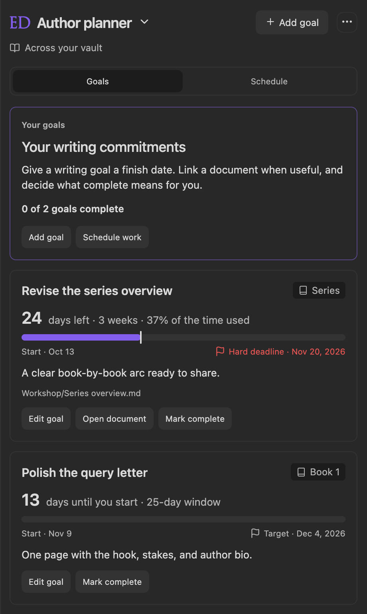
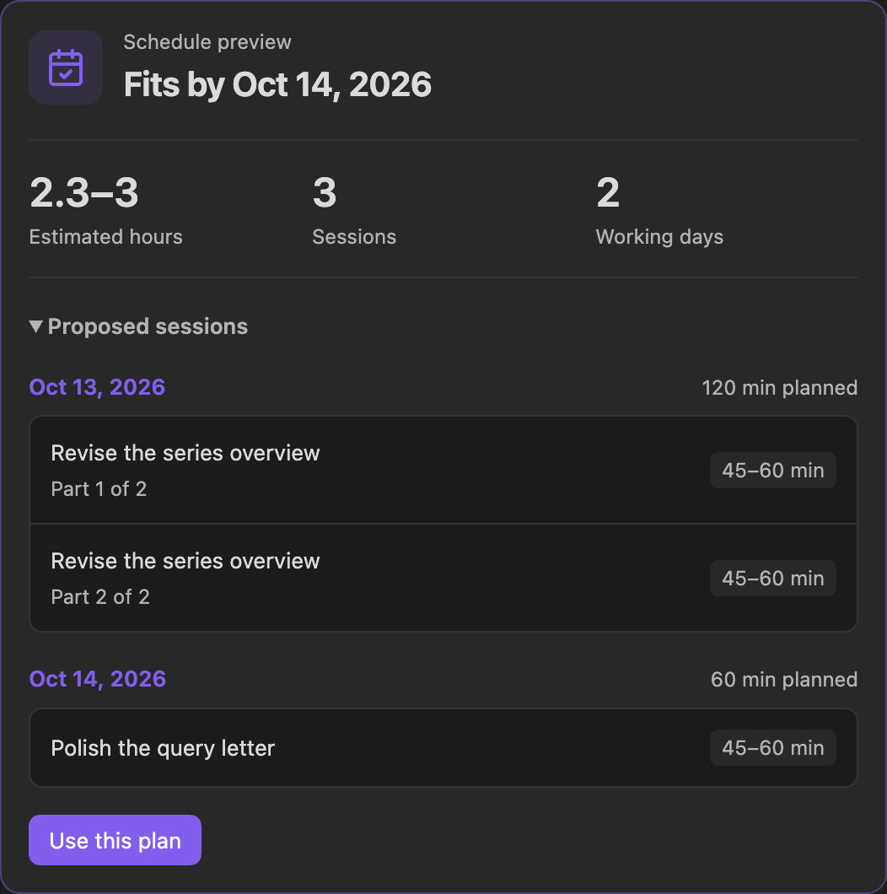

Give your own writing goals a target date and room in your working week. Run **Open author planner**, or choose **Author planner** from the panel’s mode selector. This plan spans the vault and stays separate from each book’s [Editor Engagement](Editor-Engagement).

## Add a writing goal

1. Choose **Add goal** and enter a title.
2. Describe **What does complete mean?** in your own terms: a revised chapter, a finished query letter, or another outcome.
3. Set a **Target date**. Check **This is a hard deadline** when scheduling must finish by that date.
4. Optionally add a book label, choose a vault document, and enter low/high minutes under **Effort estimate**.
5. Save. **Edit goal** lets you change these details later.

A document link opens the working file. Linking or editing it never completes the goal. **Mark complete** records your decision; **Reopen goal** brings it back. **Remove goal** removes that goal and its planned sessions while preserving the document.

## Schedule your goals

Choose **Schedule work** to open the planning dialog. Set a planning window, session length, weekday capacity, and reserve time, then review **Preview plan** before **Use this plan** saves the sessions. Estimates are editable assumptions; use your own effort ranges when known.

The **Schedule** tab shows **Queue** and **Days**, along with the forecast and available work. Target dates influence ordering; hard deadlines constrain placement. Sessions for the same goal stay ordered, while unrelated goals can still be scheduled if another goal cannot fit. Work that does not fit remains visible as unscheduled.

Marking a session **Done** from its circle records work on that session. Use **Mark complete** on the goal when its outcome is achieved. The two planners have their own capacity settings and sessions; do not assume one reserves time in the other.

## Optional Radial Timeline target dates

In goal details, select **RT book project (optional)** and a **Publishing stage**: Zero draft, Author draft, House draft, or Press ready. You can choose any available RT book, independently of the active book.

The goal shares that stage’s target date. Changing the goal’s date updates Radial Timeline; a date changed there appears here while the panel is open. Stage dates must retain their chronological order. Completing a goal records your outcome without changing the manuscript’s publishing status.

If RT, the linked book, or its stage date is unavailable, the card keeps its last synced date and shows the problem. Scheduling pauses for that linked goal until you reconnect, set the stage date, or unlink it. Standalone goals continue to work without RT. Removing a goal or unlinking it preserves the RT target date.

## Storage

Goals, sessions, and scheduling defaults are saved locally in Editorialist’s plugin data across the vault. Document links are optional. No AI, calendar account, or external scheduling service is required to use the planner.
