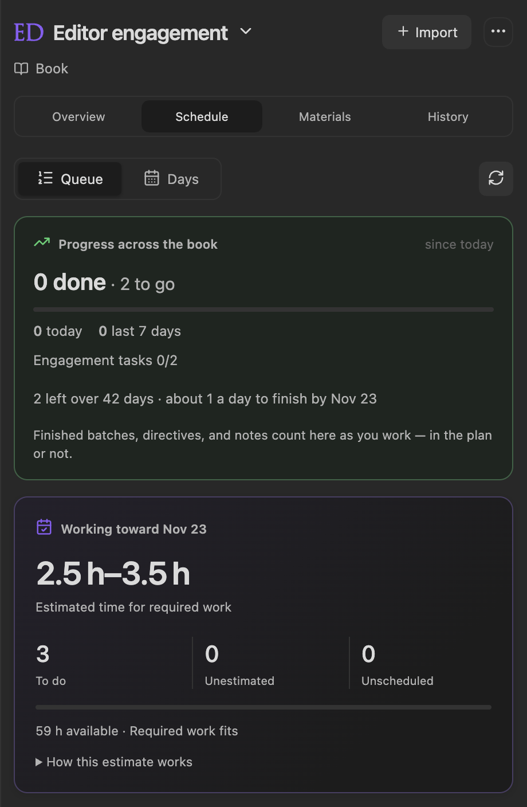
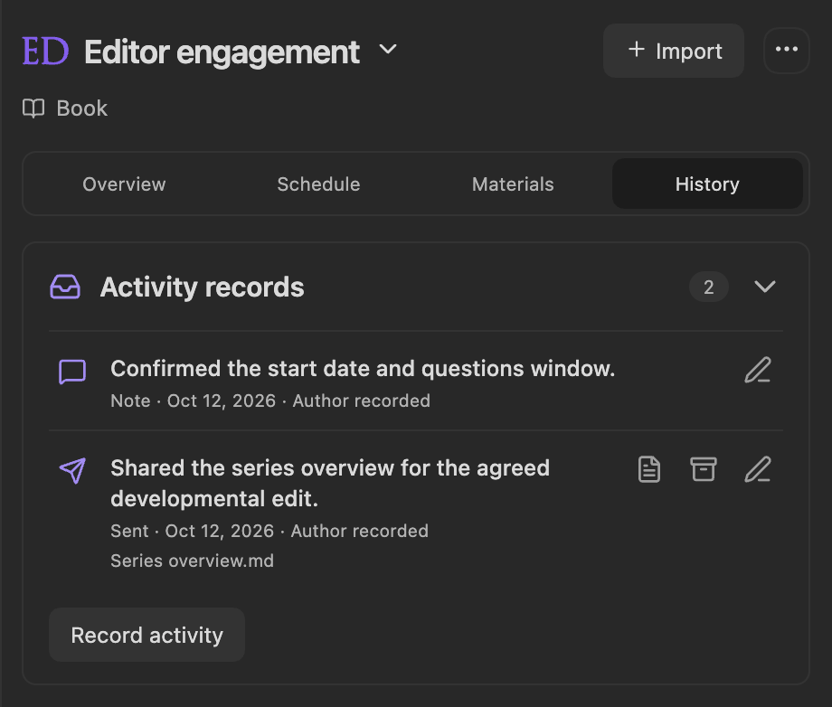

Keep an editor’s agreed dates, personal milestones, tasks, optional reference documents, and activity history together for the active book. Run **Open editor engagement**, or choose **Editor engagement** from the panel’s mode selector. **Open editorial project in workspace** opens the same plan in a full workspace tab.

## Create an engagement

1. Choose **Create engagement**. Select an existing human contributor, or enter an editor’s name when no human profiles exist.
2. Enter the engagement title and **Agreed start date**. The collaboration link, expected and actual return dates, and returned-feedback delivery are optional.
3. Set **Days for questions after return**. Once you record the actual return date, the overview shows the questions due date.
4. Save, then add your own milestones and tasks. New engagements start with empty lists.

**Editor profile** opens that contributor’s existing profile controls. If the saved profile becomes unavailable, relink it in **Engagement details**. AI contributors are excluded from the editor selector.

## Overview and milestones

The overview starts with your editor and the agreed start date, counted down in days ("9 days away", "Today", or "3 days ago"). **Next up** follows: the first unfinished item in your schedule's work queue, so the overview and the **Schedule** tab always agree on what comes first. An engagement task can be finished right there with its check circle; any other kind of work shows what it is, when it is scheduled, and an **Open** button. The card also shows the next open milestone, marked overdue in amber once its date passes, and **Open schedule**. When the queue is empty, it says so and points you to the **Schedule** tab.

**Editor return & questions**, **Engagement tasks**, **Milestones**, and **Materials & references** follow as sections you can collapse; each remembers whether you left it open or closed. Rows show their state at the left (a check circle for tasks and materials, a flag for milestones, struck through once done) and quiet icon actions at the right. Add personal milestones before or after the start date; mark them complete when you decide the work is done.

Tasks can target a milestone or the agreed start date, and optionally reference a material. Leaving a target unset gives that task no individual deadline. The schedule’s own deadline stays independently editable. The start date does not cut off work after an editor returns.

## Materials

Use **Materials → Add reference item** for a personal checklist item or a document reference. Titles, descriptions, and milestone targets help you organize it; file links are optional. Choose **Mark complete** or **Reopen item** explicitly. Editing, exporting, or linking a document does not complete an item automatically.

Prepare and exchange files through your editor’s collaboration service, email, or other agreed channel. Editorialist tracks your commitments and records; it does not send files or certify a submission.

## Schedule the work

Open **Schedule** for the ordered **Queue**, daily **Days** view, deadline, weekday capacity, and reserve time. Personal tasks join imported review batches, Editorialism directives, and pending edits. Review a schedule preview before applying it, then resolve feedback in its own workflow. **Finish session** records a planning session; source completion is separate.

See [Revision Plan](Revision-Plan) for estimates, automatic planning, delivery scheduling, prerequisites, and preserved dates.

## History and optional archives

Choose **Record activity** to record sent files, received files, or a note. A date and description are required; filenames and a vault reference are optional. Record events that have happened; put future work in the schedule. Records can be corrected later.

If you explicitly choose to archive the referenced file, Editorialist preserves one saved file, up to 64 MB, under `Editorialist/Engagement history/`. That copy remains independent of later changes to the working document. Live references follow file renames; historical filenames and archived copies preserve the record.

Earlier preparation records and archived evidence remain readable in **Preserved preparation history**, if present. The section starts collapsed; each archived export and source copy is a link that opens it. They do not gate scheduling or new activity.

## Upgrading from 2.0.0

The former **Revision plan** mode is now **Editor engagement**. Existing per-book plans, sessions, progress, and delivery links remain available. The command’s existing hotkey binding continues to use the same command ID. [Author Planner](Author-Planner) holds a separate vault-wide plan for personal goals.

Engagement details, records, and scheduling live locally in plugin data. Source feedback stays in scene notes and Editorialism documents, and optional archived references stay in the vault.
