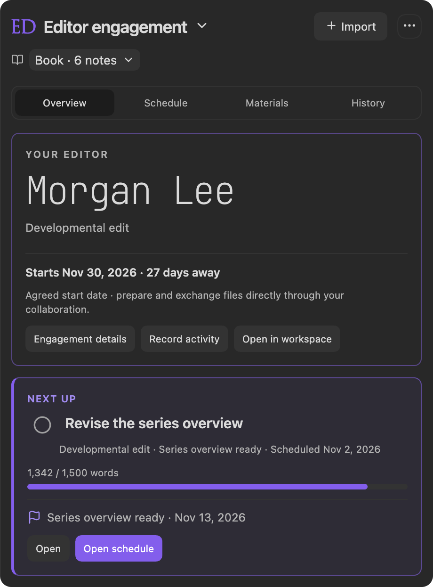
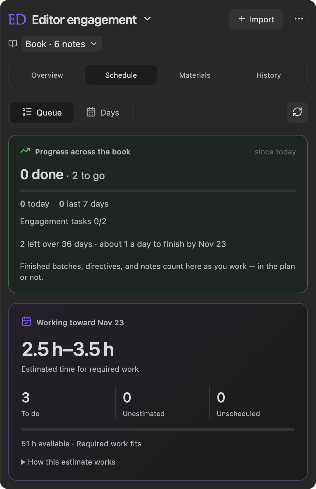
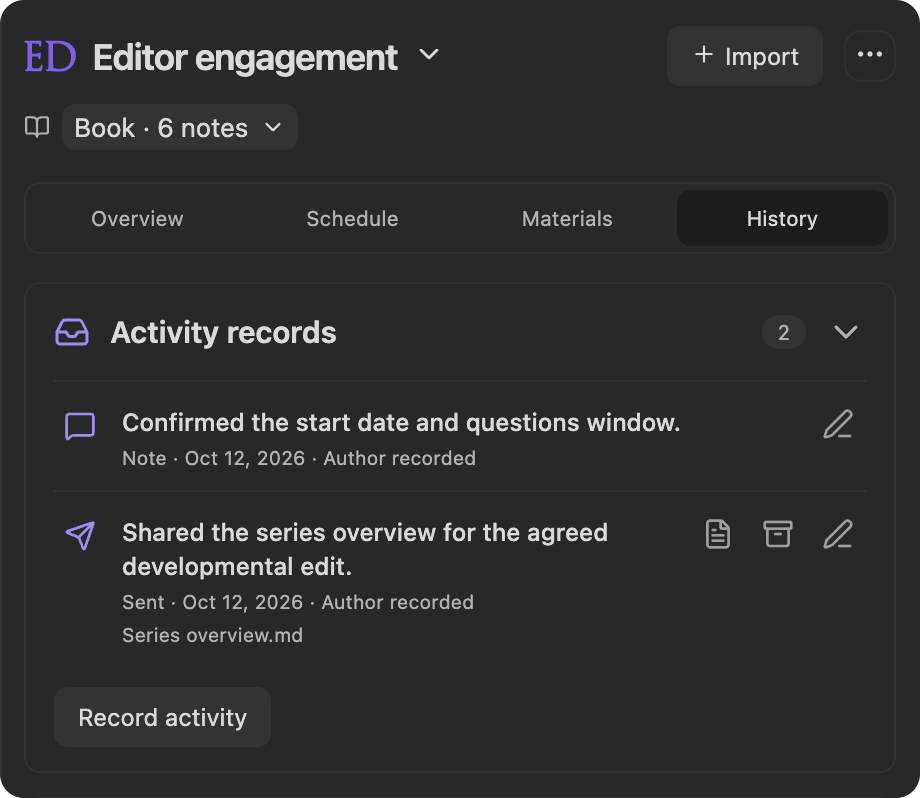

Keep an editor’s agreed dates, the documents you send, your tasks, shared milestones, and activity history together for the active book. Run **Open editor engagement**, or choose **Editor engagement** from the panel’s mode selector. **Open editorial project in workspace** opens the same plan in a full workspace tab.

## Create an engagement

1. Choose **Create engagement**. Select an existing human contributor, or enter an editor’s name when no human profiles exist.
2. Enter the engagement title and **Agreed start date**. The collaboration link, expected and actual return dates, and returned-feedback delivery are optional.
3. Set **Days for questions after return**. Once you record the actual return date, the overview shows the questions due date.

When your editor's feedback arrives and you import it, Editorialist links it to the engagement for you, as its **Returned feedback**. From then on the actual return date is the date that feedback was received, kept in one place: change it here or in **Editorial deliveries** and both show the new date. A return date you entered before the feedback arrived moves to the feedback when it links.
4. Save, then add your documents, tasks, and milestones. New engagements start with empty lists.

**Editor profile** opens that contributor’s existing profile controls. If the saved profile becomes unavailable, relink it in **Engagement details**. AI contributors are excluded from the editor selector.

## Overview and milestones

The overview starts with your editor and the agreed start date, counted down in days ("9 days away", "Today", or "3 days ago"). **Next up** names the book's next session by the same rule Today uses: a session left from an earlier day or scheduled for today comes first, then the first session of the next scheduled day, then the first unscheduled item in your work queue. Today also counts your writing goals, so when a goal session comes first there, Today names it and this card still names the book's. Click an engagement task's circle and choose **Done** to finish it right there, or **Open** to reopen it; any other kind of work shows what it is, when it is scheduled, and an **Open** button. A session whose day has passed says **Overdue** and its day in red, with a red edge on the card, as Today and the work queue mark it. The card also shows the next open milestone, marked overdue in amber once its date passes, and **Open schedule**. When the queue is empty, it says so and points you to the **Schedule** tab.

**Editor return & questions**, **Documents**, **Other tasks**, and **Milestones** follow as sections you can collapse; each remembers whether you left it open or closed. Each thing appears once, with one status: a task is done or open, a document is sent or not, and a milestone is met by what is due on it. Quiet icon actions sit at the right of each row.

## Documents

Use **Add document** for what you prepare for your editor: a query letter, a synopsis, the manuscript. A document can link its **working document** in your vault, carry a **Word limit**, and have a **Due** date.

A word limit caps the working document, a query letter at 500 words, say. Wherever that document appears, a bar shows its current prose words against the limit and turns red once over; the count leaves out properties, headings, and hidden comments. **Open working document** on the document's row, **Open document** in the schedule, or **Start** on Today opens it.

A document's tasks sit in its card, under its title. Add one with the list icon on the document's row, or choose the document in a task's **Document** field; the task then edits the same working document and word limit. Tasks with no document are listed under **Other tasks**. Click a task's circle and choose **Done** or **Open**; opening the menu changes nothing until you choose, and finished tasks are struck through.

### Record sending a document

The circle at the left of a document records sending it. Choose the date and the file you actually sent, which is usually not the working note but the Word file or PDF made from it: pick it from your vault, or **Choose from your computer…** to bring a copy in. With **Keep a copy of the file as it is now**, Editorialist keeps that copy, so later changes to the file don't change what you sent. The card then lists each send, newest first, with its date and file, and the file icon opens the copy you sent in Word or whichever app opens it. Sent a revised version? Click the circle again to record another send. A send is your record of what you did; it does not confirm that your editor received it.

## Due dates and milestones

A task or document can be due on a date of its own, when the engagement starts, or on a milestone. A task with no date of its own is due with its document. A date due when the engagement starts is a promise to your editor, so Editorialist aims to have it ready your cushion of days early; your own dates are aimed at as set. The schedule’s own deadline stays independently editable, and the start date does not cut off work after an editor returns.

Milestones are dates you share with your editor, such as an approval or a call. They have no circle of their own. Make tasks and documents due on a milestone, and it reads **Done** once its tasks are done and its documents sent; until then it names what is still open, and turns red once its date passes. A milestone with nothing due on it reads **Passed** once its date has gone by. Moving a milestone's date moves everything due on it.

Each item's edit window has a delete button. Deleting a milestone leaves what was due on it due on the same day. Deleting a document keeps its tasks, under **Other tasks**, and keeps its sends in the activity records. Deleting a task also takes its sessions off the schedule.

Prepare and exchange files through your editor’s collaboration service, email, or other agreed channel. Editorialist tracks your commitments and records; it does not send files or certify a submission.

## Schedule the work

Open **Schedule** for the ordered **Queue**, daily **Days** view, deadline, weekday capacity, and reserve time. Personal tasks join imported review batches, Editorialism directives, and pending edits. Review a schedule preview before applying it, then resolve feedback in its own workflow. Marking a scheduled session **Done** records the planning session; finishing the feedback itself is separate.

See [Revision Plan](Revision-Plan) for estimates, automatic planning, delivery scheduling, prerequisites, and preserved dates.

## History and optional archives

Choose **Record activity** to record something sent, something received, or a note. A date and description are required; the document, the file, and file names are optional. Sends you record from a document's circle appear here too, with the document's name. Record events that have happened; put future work in the schedule. Records can be corrected or deleted later.

A kept copy holds one file, up to 64 MB, under `Editorialist/Engagement history/`, and stays independent of later changes to the original. Live references follow file renames; file names and kept copies preserve the record. Deleting a record keeps its copy.

Earlier preparation records and archived evidence remain readable in **Preserved preparation history**, if present. The section starts collapsed; each archived export and source copy is a link that opens it. They do not gate scheduling or new activity.

## Upgrading from 3.2

Earlier versions gave every milestone and material its own **Done** circle, so one query letter could need a task, a milestone, and a material, each marked done separately. Now a milestone's status comes from what is due on it, and a document's from its sends, so those earlier marks are not carried over. Record a document's send to mark it sent, and delete any milestone you only made to give something a date: deleting it keeps that date on what was due on it. The **Materials** tab is now **Documents**.

## Upgrading from 2.0.0

The former **Revision plan** mode is now **Editor engagement**. Existing per-book plans, sessions, progress, and delivery links remain available. The command’s existing hotkey binding continues to use the same command ID. [Author Planner](Author-Planner) holds a separate vault-wide plan for personal goals.

Engagement details, records, and scheduling live locally in plugin data. Source feedback stays in scene notes and Editorialism documents, and optional archived references stay in the vault.
