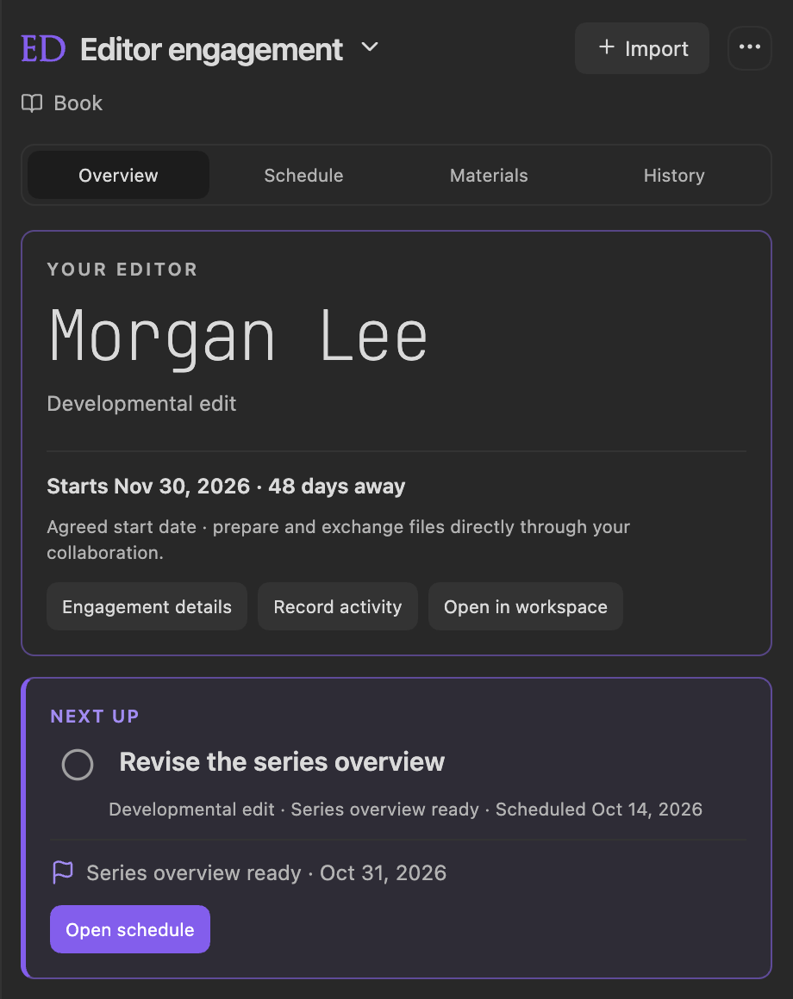

**Editorialist turns outside feedback and author notes into controlled revision workflows inside Obsidian.**

It is for writers who get notes from human editors, beta readers, or AI and want to work through those notes without losing control of the manuscript. The Ed side panel has six modes: Today, Line edits, Pending edits, Editorialisms, Editor engagement, and Author planner. Keep editorial commitments and personal goals visible, schedule the work, then resolve feedback in its source workflow.

The plugin does not rewrite your prose on import. Line edits, memos, author questions, and pending-edit notes stay reviewable until you decide what to do with them. Any passage can be archived to a per-scene cut file — from the editor's right-click menu, the suggestion toolbar, or the command palette — and completed sweeps update revision history, contributor stats, and per-scene progress.

Watch the walkthrough: [Turn Your Editor's Notes Into a Revision Schedule](https://youtu.be/uoGUkF6RQ2E) (Volume 9 on the Radial Timeline YouTube channel).

## Feedback and planning

Review batches arrive in Editorialist’s format, packaged by an AI: the AI’s own review, or a human editor’s or beta reader’s notes converted with the formatting instructions. You choose the AI and paste its formatted response into Editorialist. The plugin makes no network calls and holds no API keys.

The planners work locally without AI. [Editor Engagement](Editor-Engagement) records agreed dates, personal milestones, tasks, optional references, and activity history for the active book. [Author Planner](Author-Planner) schedules your own writing goals across the vault.

[Radial Timeline](Radial-Timeline-Integration) adds book context and scene IDs, and can optionally share publishing-stage target dates with author goals. Editorialist also works independently.

## What It Helps With

- Turning AI, editor, or beta-reader feedback into reviewable suggestions.
- Walking a revision pass scene by scene instead of managing loose notes.
- Keeping every manuscript change explicit and reversible during the session.
- Tracking accepted suggestions and revision progress, and seeing which readers, editors, and AI models give the most useful feedback.
- Keeping structural guidance separate from line-level edits through Editorialisms.
- Scheduling all of it against a deadline and seeing progress across the whole book.

## Standard Review Operations

The standard Review workflow supports a full set of scene-level editorial moves:

| Operation | What it lets you do |
|---|---|
| **Edit** | Review a specific suggested change against the original passage. |
| **Move** | Relocate a passage before or after a named destination anchor. |
| **Cut** | Remove a passage, with optional backup to the scene's cut file first. |
| **Condense** | Tighten a passage between two anchors into a shorter version. |
| **Expand** | Develop, slow down, or decompress a beat with finished prose or advisory guidance. |
| **Memo** | Keep general thoughts, strengths, issues, or scene notes beside the sweep without changing prose. |

## Five panel modes

Use the view name beside the Ed logo to switch modes. Book-scoped modes use the active-book header and **Import**. Author planner shows **Across your vault** and **Add goal**.

| Mode | Use it for |
|---|---|
| **Editor engagement** | Record your editor’s agreed dates, milestones, tasks, references, and history. Schedule revision work and see progress across the whole book. |
| **Author planner** | Set vault-wide writing goals with completion descriptions, target dates, optional document links, and capacity scheduling. |
| **Line edits** | Imported review batches: scene-level edits such as expand, condense, cut, move, and line edits, plus `%%query: question%%` responses and scene memos. Each batch is a review block appended to the scene, worked through, then cleaned away. Each scene can carry multiple batches from different manuscript shares or review passes. |
| **Pending edits** | The notes in each scene’s **Pending Edits** property (the revision notes you keep with Radial Timeline, including Inquiry follow-ups), walked scene by scene across the active book. |
| **Editorialisms** | A long-form checklist of directives pinned to the passages they concern, kept permanently as its own document: structural guidance, theme/subplot notes, and general feedback with no line edits. Record decisions or questions on directives and hand them to AI. |

Alongside these, the **Contributor directory** (**Settings → Contributors**) shows which readers, editors, and AI models give the most useful feedback. The Line edits view’s **How Editorialist works** section sums up the same four workflows: imported review batches, Editorialisms, pending edits, and the contributor directory.

## What You Work With

| Object | What you get | When you get it | Where it lives |
|---|---|---|---|
| **Review batch** | The AI's formatted response: line edits, cuts, moves, condenses, expands, and memos | After you send the formatting instructions and manuscript text to an AI, or ask an AI to convert human notes | On your clipboard until you import it |
| **Review block** | The imported part of a review batch for one scene | When you import a review batch through the launcher | Appended to the bottom of each targeted scene note until you clean it away |
| **Editorialism** | A structural checklist or manuscript-level directive set | When a reviewer gives broad guidance that should be worked over time | A separate markdown file under `Editorialist/<Book>/`, kept permanently |
| **Editor engagement** | Dates, milestones, tasks, references, and an activity record | When you create an engagement for the active book | Plugin data; optional archived references in the vault |
| **Author goal** | A writing commitment with your own completion definition and target date | When you add a goal in Author planner | Vault-wide plugin data; its linked document stays in the vault |
| **Editorial delivery** | One editor’s handoff, with attribution, received date, return deadline, and links to feedback | After importing and linking its sources | Plugin data for the book |
| **Planning session** | A dated or unscheduled task with an effort range | When you add work or apply a draft schedule | Plugin data, linked to the original feedback or personal goal |
| **Pending edit** | A note-to-self or Inquiry follow-up to review later | When a line is added to a scene’s **Pending Edits** property, by you or by Radial Timeline | The scene’s **Pending Edits** property, read across the active book and shown in Pending edits mode |

## Core Workflow

1. **Copy the formatting instructions** from the review launcher — they include the [format specification](Importing-Reviews) and your book's scene IDs, or its note names where notes have no IDs.
2. **Get suggestions.** Paste the instructions into your AI conversation along with the prose. For human feedback, collect your reviewer's notes in any form — a photo of a marked-up page, a document, an email — and have an AI shape them into a batch using the same instructions.
3. **Import the batch** through the launcher; Editorialist appends review blocks to the bottom of the targeted scene notes.
4. **Walk the [guided review sweep](Line-Edits)** — accept, reject, rewrite, or defer each suggestion.
5. **Finish.** Per-scene progress, contributor stats, and revision history update as each sweep completes.

To schedule everything at once, open **Editor engagement → Schedule** (or the schedule shown before you create an engagement) and choose **Auto-plan**; it spreads every open batch, directive, and pending edit across your working days. For one editor's handoff, group its imported batches and Editorialisms into an **Editorial delivery**, then choose **Plan this delivery**. Review the draft before applying it; priorities and estimates are editable. See [Revision Plan](Revision-Plan).

## Pages

| Page | What's there |
|---|---|
| [Getting Started](Getting-Started) | Commands and your first review sweep |
| [Editor Engagement](Editor-Engagement) | Agreed dates, editor return, milestones, references, and activity history |
| [Author Planner](Author-Planner) | Personal goals, target dates, linked documents, and optional RT stage dates |
| [Revision Scheduling](Revision-Plan) | Progress across the book, priorities, capacity, auto-planning, and delivery tracking |
| [Line Edits](Line-Edits) | The main working surface — sessions, the suggestion toolbar, statuses |
| [Pending Edits](Pending-Edits) | The active-book queue for author notes and Inquiry follow-ups |
| [Editorialisms Panel](Editorialisms-Panel) | Structural guidance documents and the checklist workflow |
| [Importing Reviews](Importing-Reviews) | Review batches, review blocks, and Editorialism files |
| [Settings Reference](Settings-Reference) | All three settings tabs: Core, Contributors, Configuration |
| [Radial Timeline Integration](Radial-Timeline-Integration) | What the companion plugin adds |

## License

Source-available, non-commercial software license. Free for personal, educational, and professional creative work — including manuscripts and other commercial creative output produced with the plugin. Commercial use of the software itself, redistribution, and forks for public distribution require written permission. See [LICENSE](https://github.com/EricRhysTaylor/Editorialist/blob/main/LICENSE) for full terms.
