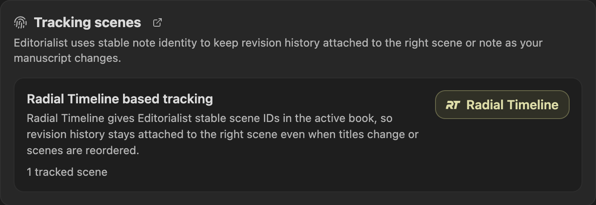

[Radial Timeline](https://community.obsidian.md/plugins/radial-timeline) is a companion plugin for manuscript structure. Choose **Follow Radial Timeline** in the manuscript target selector to use its active book for review targeting. You can choose an independent folder or note while Radial Timeline remains enabled. Pending-edits review continues to use its active book.

The integration is optional. Editorialist works without Radial Timeline using its manuscript target selector, its own note IDs, or path-based tracking when needed. Folder targets can include subfolders and exclude supporting material.

## What Radial Timeline adds

| Capability | Without RT | With RT |
|---|---|---|
| Book scope | Selected folder, pinned note, or explicitly selected whole vault | Optional active-book scope for panels, inventory, and stats |
| Scene tracking | Editorialist stable note IDs, or path-based fallback | Radial Timeline scene IDs shared with manuscript exports |
| Pending edits | Active-book pending-edits sweep is not available | Revision notes collected across the active book |
| Scene inventory | Plain scene list | Scene status and stage glyphs when matching frontmatter exists |
| Author goals | Standalone vault-wide goals with their own dates | Optional shared publishing-stage target dates for any book; completion stays your decision |
| Review templates | Scene IDs from scoped notes when available; note names for notes without IDs | The template includes the active book's scene IDs |

See [Author Planner](Author-Planner#optional-radial-timeline-target-dates) for linked dates, stage ordering, and unavailable-link behavior.

## Availability

If Radial Timeline is missing, disabled, or has no active book, Editorialist reports that state for pending-edits review and continues with its built-in import and tracking modes. Imported review batches do not require Radial Timeline.
