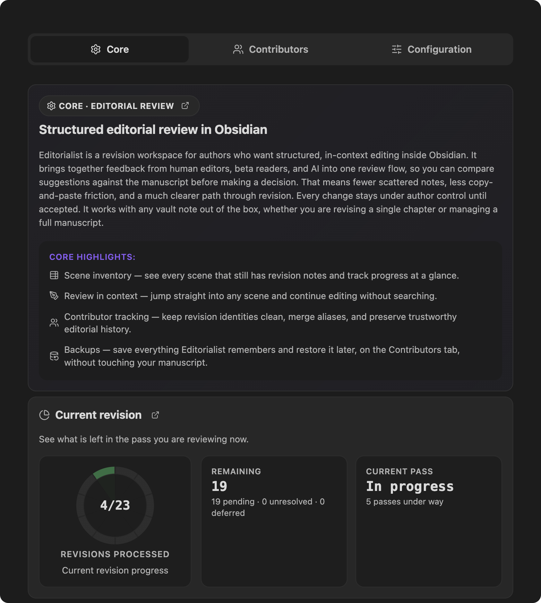
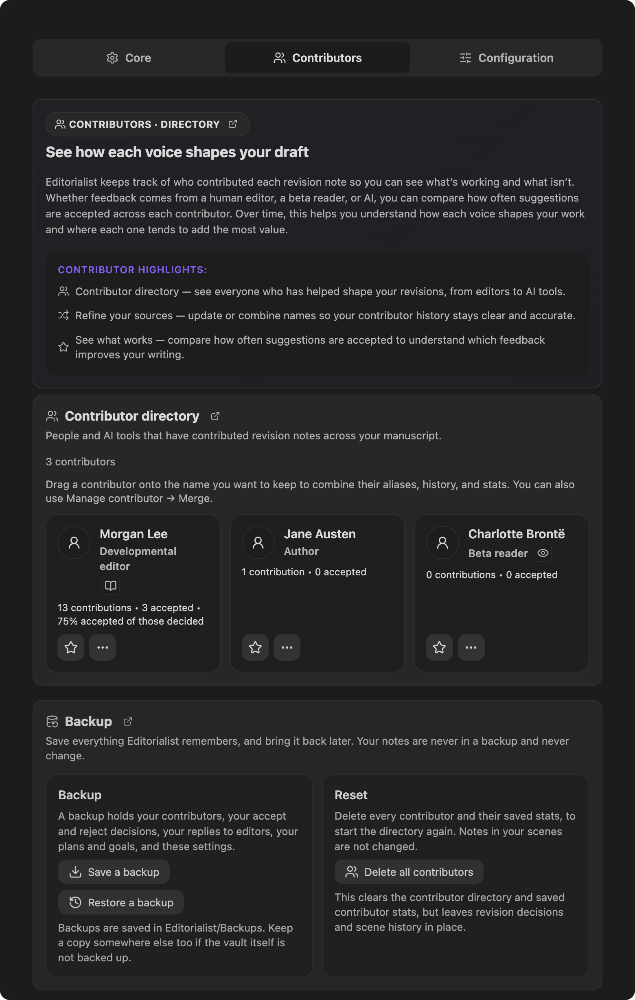
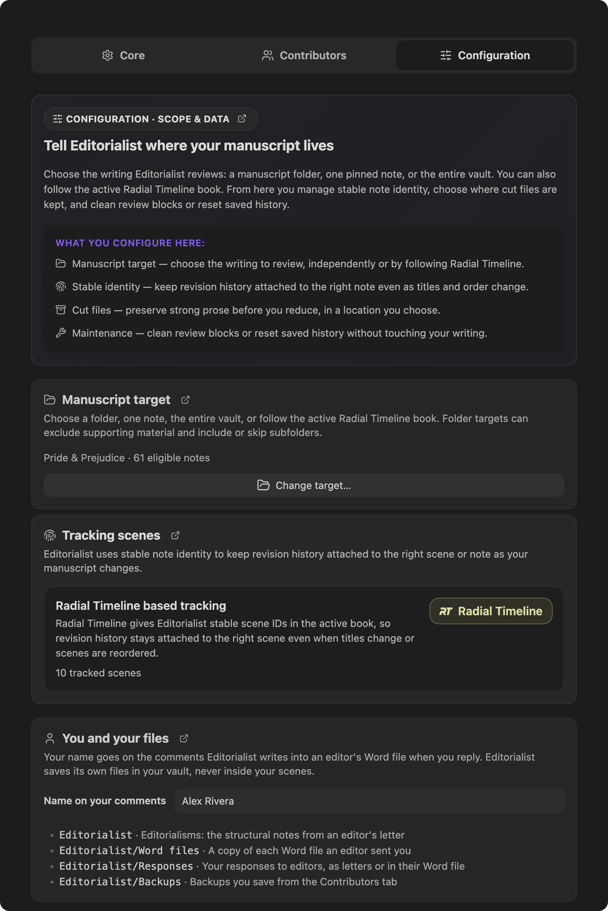
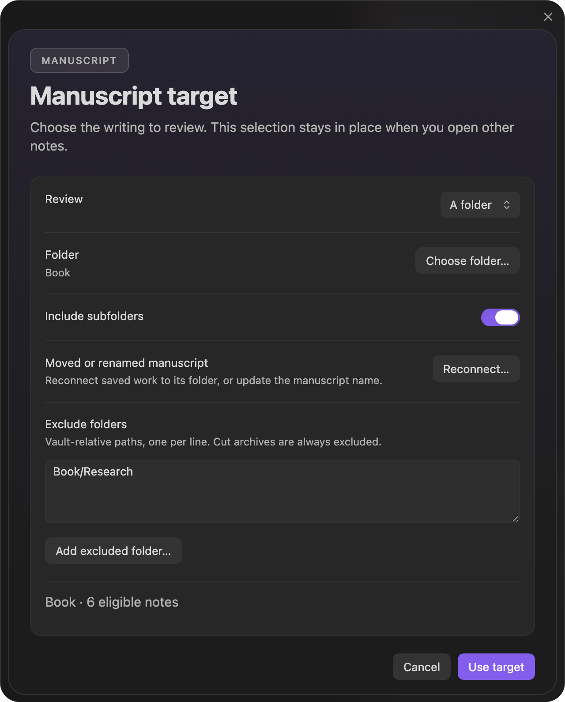

Editorialist's settings are organized into three tabs: **Core**, **Contributors**, and **Configuration**. Core is the dashboard; Configuration holds your manuscript, your name and Editorialist's folders, tracking, cut files, notes an AI writes into scenes, effort estimates, and maintenance.

On Obsidian 1.13 or later, the search box in Obsidian's settings finds Editorialist's main settings, such as the manuscript target, the name on your comments, the cut folder, contributors, and backups. Choosing one opens Editorialist's settings at that section.

---

## Core tab

**Core · Editorial review** — the dashboard for the active book's revision state.

### Radial Timeline card

If the [Radial Timeline](Radial-Timeline-Integration) plugin is not installed, a card explains what it adds and links to install it. With it installed, Editorialist scopes everything below to the active book.

### Revision progress

A ring showing how much of the pass you are reviewing now is done, with **Remaining** and **Current pass**.

### Scene inventory

A table of tracked scenes or notes that have imported revision notes:

| Column | Meaning |
|---|---|
| Completion | Per-scene polish state, from `Editorialist.revision` / `Editorialist.revision_updated` frontmatter |
| Scene | Scene name; with Radial Timeline installed, Status glyphs (**T**odo / **W**orking / **C**omplete) and Stage glyphs (**Z**ero / **A**uthor / **H**ouse / **P**ress) render from shared frontmatter |
| Imports | Review batches imported into the scene |
| Passes finished | Review passes finished in this scene |
| Open / Done | Suggestion counts |

Scenes with pending edits show a badge. When an active book or manuscript folder is set, a filter button narrows the table to that scope.

### Pending edits

When Radial Timeline is installed and has an active book, this section summarizes free-form revision notes collected from scene frontmatter: scene count, item count, human notes, and inquiry count. The **Start review** button launches the [pending-edits flow](Line-Edits#pending-edits-review) and is disabled when there is nothing to review.

### Revision history

Lifetime totals: total suggestions, accepted / rejected / rewritten actions, and finished passes.

---

## Contributors tab

**Contributors · Directory** — every reviewer who has ever contributed a batch, human or AI.

### Contributor directory

A card grid, one per contributor:

- **Identity** — display name, avatar (or AI provider brand icon, derived from the `Provider:` / `Model:` batch metadata), role icon, and strength icons.
- **Stats** — total suggestions, accepted, rewritten, and the share you accepted of those you have decided. Suggestions you have not decided yet do not count against a contributor.
- **Trusted badge** — earned once you have decided at least 5 of a contributor's suggestions and accepted at least 80% of them.
- **Aliases** — alternate names that have been merged into this contributor.
- **Star** — mark a contributor to enable the starred-only filter in [Line edits](Line-Edits).
- **Manage (…)** — opens contributor actions:
  - *Edit* — display label, how you use the contributor (Developmental editor, Line editor, Copy editor, Beta reader, Generalist, AI assistant), and optional strengths (Clarity, Tone, Pacing, Dialogue, Structure, Character, Worldbuilding, Tightening).
  - *Move a pass to someone else* — choose one of this contributor's imported passes and say who it really came from: another contributor, or a new one. Use it when a pass was filed under the wrong person, such as a copy edit credited to the developmental editor. The notes in your scenes and your decisions on them stay exactly as they are; the pass's stats move to the contributor you chose.
  - *Merge with another contributor* — for two names that are the same person: everything from this contributor moves into the other, and this name becomes one of their alternate names.

### Backup

- **Save a backup** — saves everything Editorialist remembers to a file in **Editorialist/Backups**: your contributors, your accept and reject decisions, your replies to editors, your plans and goals, and your settings. Your notes are not in it; they are already in your vault.
- **Restore a backup** — choose one of the backups in **Editorialist/Backups** to go back to. Everything Editorialist remembers returns to how it was then, and anything since is replaced. Your notes do not change. If you may want the current state back, save a backup first.
- **Delete all contributors** — clears the contributor directory and saved contributor stats. Revision decisions and scene history stay in place.

---

## Configuration tab

**Configuration · Scope & data** — where review scope, tracking identity, cut-file location, and maintenance actions live.

### Manuscript target

Use **Change target…** here, or click the manuscript line beneath a panel header.

- **Follow Radial Timeline** — use its active book while the plugin is enabled. The list shows your books and which ones have an editor engagement. Choosing another book switches Radial Timeline to it too. If a book's folder is missing, you are asked to choose a target.
- **A folder** — choose an existing vault folder. Include or skip subfolders and exclude supporting folders by their vault-relative paths. Plain Markdown notes need no `Class: Scene` property.
- **Current note** — pins the note open when you choose this option. Opening another note does not move the target.
- **Entire vault** — explicitly includes Markdown notes across the vault, subject to exclusions.

Cut archives are excluded from review targets. The selector previews the number of eligible notes. Import previews name the target and list destinations; a change to the target or eligible note set requires a new preview before importing.

New installations ask you to choose a target. Existing installations retain their previous selection until you choose one; the unbounded mode is labeled **Entire vault**. Choosing a folder works even while Radial Timeline is enabled.

Revision plans and deliveries still require a folder target (or a Radial Timeline book with a folder). The active-book pending-edits review still requires Radial Timeline. Manuscripts remain associated by folder; saved target presets are separate work.

### You and your files

- **Name on your comments** — the name on the comments Editorialist writes into an editor's Word file when you reply (see [Responding to your editor](Importing-Reviews#responding-to-your-editor)). The response window asks for it the first time if it is empty.
- The folders Editorialist saves into, all inside your vault and never inside your scenes:
  - **Editorialist** — Editorialisms, the structural notes from an editor's letter.
  - **Editorialist/Word files** — a copy of each Word file an editor sent you.
  - **Editorialist/Responses** — your responses to editors, as letters or in their Word file.
  - **Editorialist/Backups** — backups you save from the Contributors tab.

### Tracking

Shows which tracking mode is active and why:

| Mode | When |
|---|---|
| Radial Timeline based tracking | Radial Timeline is installed and an active book is set — scenes are tracked by Radial Timeline scene IDs |
| Using stable note IDs | Editorialist is using injected or existing frontmatter IDs for rename-safe tracking |
| Keep tracking through renames | No permanent IDs are available — notes are tracked by file name, so a rename can lose their history |

When notes are tracked by file name, **Add permanent IDs** adds an `editorial_id` property to tracked notes that do not already have one.

#### What Editorialist writes to frontmatter

Three things, and only these keys:

| Key | When |
|---|---|
| `Editorialist.revision`, `Editorialist.revision_updated` | A review pass completes |
| `editorial_id` | You run **Add permanent IDs** |
| The pending-edits field | You work an item in the [Pending Edits](Pending-Edits) queue |

Frontmatter is written through Obsidian's own properties API, which rewrites the
whole YAML block rather than editing single lines. So a write can also drop YAML
comments, change quote style, or reorder keys. This is how frontmatter is edited in
Obsidian generally — the built-in Properties editor and other plugins that write
frontmatter behave the same way — but it is worth knowing if you keep comments or a
hand-ordered layout in your scene YAML.

Note *body* text is never reformatted. Importing a review block appends it and
leaves the rest of the file, including trailing blank lines, exactly as it was;
cleaning one removes the block and repairs only the join.

### Cut location

A cut file is a general-purpose archive, reachable wherever you are working:

- **Editor right-click** — select a passage in a scene note of the active book and choose **Ed — backup selection to cut file**. The `Backup selection to cut file` command does the same from the palette.
- **Suggestion toolbar** — **Backup to cut file** archives the suggestion's target passage; Shift + click opens the cut file instead.
- **Side panel actions menu** — **… → Open cut file** opens the active scene's cut file in the split below the panel.

Back a passage up before you accept a **Cut** if you want a copy kept. Accepting removes the passage from the manuscript immediately, and the only way back is the single-step, same-note [Undo](Line-Edits#undo).

The archive is a per-scene cut file — one per scene, named after the scene and tagged with its own `Class: Cut` frontmatter. Each archived block stores source, scene, and backup timestamp, plus operation, suggestion ID, contributor, and reason when they are available. Cut files are separate from review status and acceptance decisions: backing a passage up never changes a suggestion's status.

- **Cut folder** — a path field. Leave empty to use the default: a **Cut** folder inside the book's folder when there is an active book, otherwise a **Cut** folder beside each scene.
- **Save** / **Use default** buttons apply your folder or go back to the default.
- If a scene sits outside the active book folder, cut files fall back to that scene's own folder.

### Notes an AI writes into a scene

Off by default. If an AI can edit your vault, it may write its revision notes straight into a scene instead of giving you text to paste. With **Look for notes an AI wrote into a scene** on, opening the launcher on such a scene offers to bring those notes in for review. It never changes your writing on its own.

### Revision effort estimate

How Editorialist estimates the time an Editorialism's work will take, for planning: **Words per new scene**, **Drafting rate (words / hour)** for new prose, **Minutes per Editorialism item**, and **Daily writing hours**. Each must be a positive number; anything else is put back to its previous value.

### Maintenance

Bulk operations. Cleanup actions ask for confirmation before removing review blocks:

- **Clean all scenes/notes** — remove imported review blocks from tracked scenes or notes. Accepted manuscript edits and saved history stay in place.
- **Clean completed scenes/notes** — remove imported review blocks only from completed scenes or notes.
- **Reset one batch** — choose any imported pass, most recently active first, and remove its saved decisions and stats. Only that batch's decisions go: when a note holds review blocks from several imports, the other batches keep theirs. Review blocks still present in notes are discovered again.
- **Reset all history** — clear saved batch history and decision stats. Review blocks still present in notes are discovered again.

Cleanup removes review blocks that carry a recognizable closing fence, and only those. A block whose fence has gone missing — edited away by hand, mangled by a sync conflict, or indented into a list — has no knowable end, so Editorialist leaves it where it is rather than guessing how far it runs. It is counted and named in the notice instead:

> 1 unfenced review block was left in place — it has no closing fence, so remove it by hand.

That count reaches every cleanup route, including **Clean all scenes**, so a cleanup never reports success over a note it has only partly cleared. Delete the block by hand and the note is clear.

---

## Good to know

- Importing a batch appends review blocks to scene notes; accepting suggestions is what changes manuscript prose.
- Cleaning review blocks removes imported blocks from notes but keeps accepted edits and saved history.
- Resetting saved history clears Editorialist's saved decisions and batch tracking, not review blocks still written into notes.

### Reconnect a moved or renamed manuscript

Open the manuscript target selector and choose **Reconnect…**. It appears at the top when a saved manuscript's folder is missing, and below **Include subfolders** for a folder target. Select its saved association, choose the replacement folder, and review the manuscript name, revision plans, deliveries, tracked notes, and affected Editorialisms before applying. If the missing folder's name matches one Radial Timeline book, that book's folder is filled in for you to review. The original folder must be unavailable when reconnecting to a different folder. To change only a standalone manuscript name, keep the existing folder selected.

Folder renames observed inside Obsidian update saved references automatically, including moves of a parent folder. If the destination already has manuscript records or review history, both sets are retained and reconnection is blocked until a different destination is chosen. Editorialisms sharing the old name with another manuscript require explicit selection. Their file locations and agenda bodies stay intact; only the selected book fields change. Radial Timeline book titles are managed in Radial Timeline.

No manuscript metadata note or manuscript ID is required. The name-to-folder association is stored in Editorialist’s plugin data. Saved records for unavailable manuscript folders remain recoverable while other manuscripts are in use.
