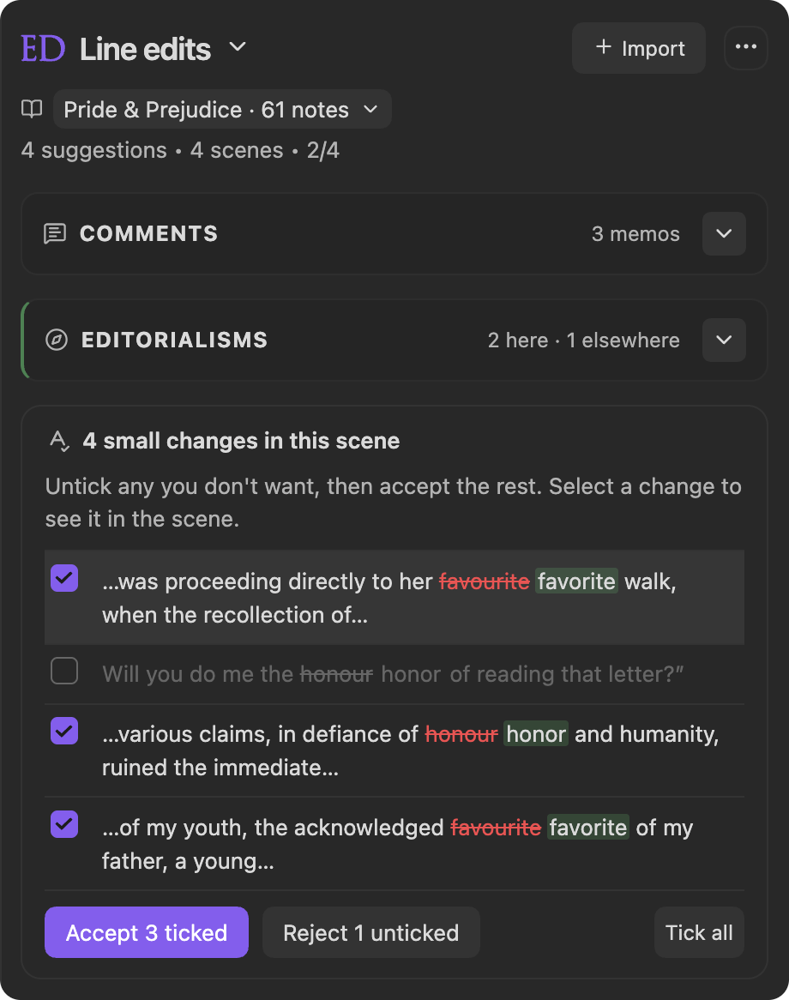
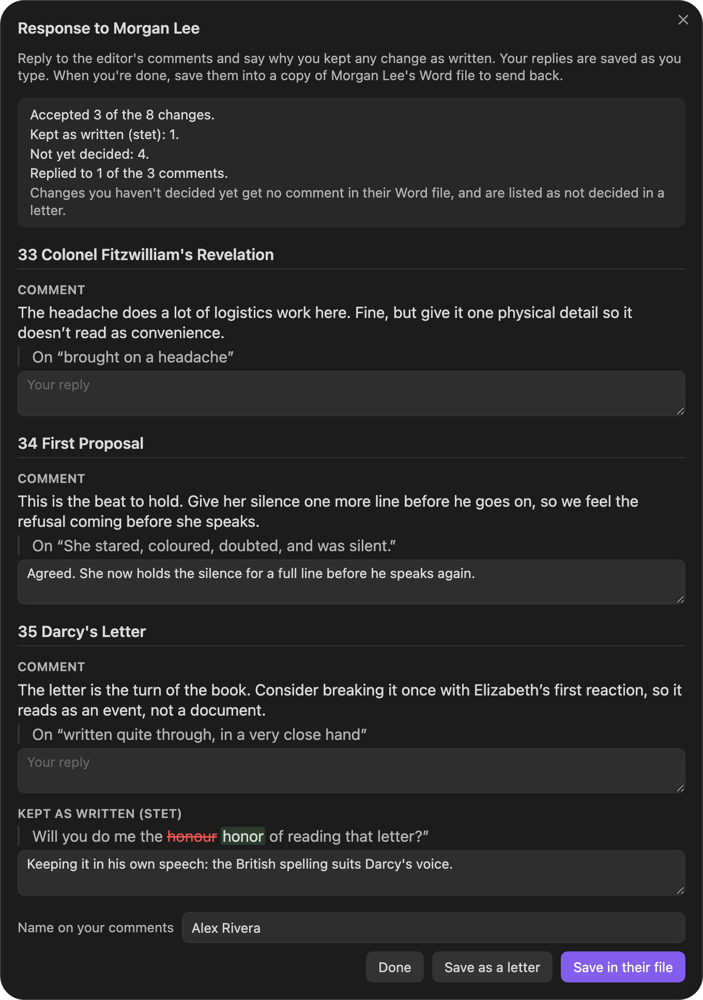

Your copy editor's Word file comes straight in. Every tracked change becomes a suggestion in its sentence, comments become reasons, and small fixes arrive as one ticked list per scene. When you're done, Editorialist writes your replies and stets into a copy of their own document, ready to send back.

This page walks the whole round trip, from the file you send to the file you send back. No AI is involved at any step: what you review is exactly what your editor changed.

## 1. Send a file that keeps scene IDs

Radial Timeline makes the file you send. In its manuscript export, choose the **Editor round** option. It writes a Word file with each scene's ID in its heading and your author queries as margin comments, and strips your private notes. See Radial Timeline's [Manuscript export](https://github.com/EricRhysTaylor/radial-timeline/wiki/Manuscript-Export).

The scene IDs tell Editorialist which scene every change belongs to. A Word file without them still comes in: each change is placed by finding its sentence in your book.

Your editor works in Word as usual, with **Track Changes** on and comments in the margin, and sends the file back.

## 2. Bring in their Word file

1. Run **Open review launcher** from the command palette, or choose **Import** in the Ed panel.
2. The first card is **Your editor's Word file**. Choose **Choose Word file…** and pick the .docx your editor returned.
3. The launcher counts what it found, for example *12 edits, 1 cut, 4 comments by your editor*. Nothing in your manuscript changes until you accept each one.
4. If more than one person tracked changes in the file, choose whose to bring in under **Changes by**. Set **Their role**; it starts as **Copy editor**.
5. Choose **Import and start review**, or **Preview destinations** to see where each change lands first.

The launcher lists anything it leaves for you to do in Word or by hand, such as a font change or a change to a heading. See [Word files with tracked changes](Importing-Reviews#word-files-with-tracked-changes) for the full list.

Editorialist keeps a copy of the file in **Editorialist/Word files** in your vault. That copy is what your replies go into at the end. Your editor is credited as the contributor, and the pass joins their [editorial delivery](Revision-Plan).

## 3. Review the changes, scene by scene

[Line edits](Line-Edits) opens on the first scene with changes and walks the pass scene by scene.

- **Each tracked change is a suggestion covering its sentence**, shown as the sentence read before the edit and as your editor left it. Several changes in one sentence come in together as one suggestion.
- **A comment on a changed sentence is that suggestion's reason.** Any other comment appears with the scene's comments in the panel. Comments above the first scene heading, such as overall notes on a title page, show with every scene.
- **A deleted paragraph is a cut.** A paragraph your editor added joins the end of the paragraph above it.
- **Italics and bold your editor added or took off come in too.** Applying the suggestion writes them into your scene.

### Small fixes come as one ticked list

When a scene has two or more small changes, such as a comma, a hyphen or a spelling, they arrive together in one list at the top of the panel. Each row shows the change in its sentence, with the old words struck through and the new ones highlighted. Select a row to see that change in the scene.

Every change starts ticked. Untick any you want to keep as you wrote it, then choose **Accept 3 ticked** (or **Accept all 4** when every row is ticked). **Reject 1 unticked** turns down the rest in one step; leave them unticked to decide later instead. **Tick all** and **Untick all** change every row at once.

When the same fix comes up again in a later scene, its row says where you accepted or rejected it before. Larger rewrites keep a full card each, below the list.

## 4. Accept, stet or rewrite

Every change ends in one of three decisions, and each one tells your editor something different:

| Decision | How | What your editor sees |
|---|---|---|
| **Accept** | **Apply** on the suggestion toolbar, or the ticked list | Their tracked change, left for them to accept in Word |
| **Stet** (keep it as you wrote it) | **Reject** | A comment saying **Stet**, with your reason |
| **Rewrite** | Write your own version in the scene, then choose **Rewrite myself** on the toolbar | A comment saying **Rewritten another way**, with your reason |

Your editor's own changes are applied word for word. Your quotation marks, dashes, italics and bold stay as they are in the rest of the sentence.

### Undo

- **One change.** While you're still on the note, the suggestion toolbar's **Undo** takes back the change you just applied.
- **A scene's copy edits.** After you accept from the ticked list, the list shows **Undo all** (with the count) to take back everything you just accepted there, even once the scene is complete. It works until you change the scene some other way; from then on, Obsidian's own undo is the tool.

## 5. Answer your editor as you go

Editorialist collects your answers while you review, so the response is mostly written by the time you finish.

- **Reply to a comment.** Under each of your editor's comments in the panel, choose **Reply**.
- **Say why you kept a change.** On a change you rejected or rewrote, choose **Say why you kept it**. A reason is optional; a stet on its own is a complete answer.

Under **Scene complete** and **Batch complete**, a card lists the changes you kept or rewrote in that scene, each with its reason, so you can add one you skipped.

## 6. Save your answers in their Word file

When every scene is decided, the completion card leads with **Write your response to** *(your editor)*. You can also run **Write your response to the editor** from the command palette at any point in the pass.

The response window lists every comment and every change you kept or rewrote, scene by scene. Each is a card that reads like a review thread: your passage, then your editor's words, then a box for your reply. Counts at the top show how many changes you accepted, kept as written, rewrote or haven't decided yet, and how many comments you replied to. Replies save as you type, so you can close the window with **Done** and come back.

1. The first time, enter your name under **Name on your comments**. Word shows it on each of your comments. (It is also in **Settings → Configuration → You and your files**.)
2. Choose **Save in their file**.

Editorialist writes your answers into a copy of your editor's document, saved in **Editorialist/Responses** as *(their file name)* **with replies** *(date)*:

- Each reply appears under your editor's comment, in the same thread.
- Each change you kept gets a comment saying **Stet**, or **Rewritten another way**, followed by your reason. Where your editor had explained that change in a comment, it appears as your reply to them.
- Their tracked changes stay exactly as they were. Most publishers ask authors to leave a copy editor's changes for the editor to accept, and a stet comment is the standard way to mark one you want kept.

The window then says how many replies are in the file. Any it could not place in the document can go in a letter too: **Save as a letter** writes a separate Word file with your replies and reasons, scene by scene, if your editor prefers that.

## 7. Send it back

After saving, choose **Open file** to read it over in Word, or **Show in Finder** (**Show in File Explorer** on Windows) to open the folder with the file selected, ready to attach to an email.

Saving the response also completes the **Write your response to** task in your [revision plan](Revision-Plan).

Write the response before you clean the review blocks out of your scenes. It is built from those blocks, so the completion card offers **Write your response to** first and **Clean review blocks** after it.

## See also

- [Importing Reviews](Importing-Reviews#word-files-with-tracked-changes): exactly how tracked changes and comments are converted
- [Line Edits](Line-Edits#copy-edits): the ticked list, the suggestion toolbar and pass completion
- [Responding to your editor](Importing-Reviews#responding-to-your-editor): the response window and the letter
